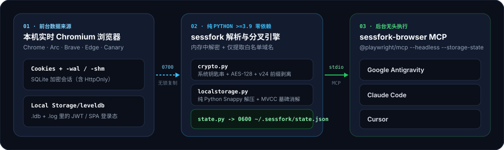

# sessfork

[](https://github.com/wasabihu/sessfork/actions/workflows/ci.yml)
[](LICENSE)
[](pyproject.toml)
[](pyproject.toml)

[English](README.md) · **简体中文** · [交互式可视化指南](https://wasabihu.github.io/sessfork/) · [压测与基准数据](docs/benchmarks.md)

**一键把本地 Chrome 登录态（Cookies + LocalStorage）无锁分叉到 AI 后台无头浏览器 —— 零窗口抢焦点、零运行时依赖。**


当你让 AI 编程助手（[Google Antigravity](https://antigravity.google/docs/commands/browser/)、Claude Code、Cursor）直接连接你正在用的 Chrome 来复用登录态时，AI 会频繁把浏览器窗口抢到前台、乱切标签页，直接打断你写代码或看文档的节奏。

`sessfork` 把**前台阅读视图**与**登录凭证状态**彻底解耦：只需一行命令，它就能无锁快照 Chromium 的 SQLite `Cookies` 与 LevelDB `Local Storage/leveldb`，通过系统原生 API 在内存中解密，完成 SPA/JWT `localStorage` 的 MVCC 墓碑消解，生成严格 `0600` 权限的 [Playwright `storageState`](https://playwright.dev/docs/api/class-browser) 文件，并自动为本机 AI 工具配置静默后台无头浏览器（`sessfork-browser`）。

---

## 懒人 10 秒上手（装一次，以后只管对 AI 说话）


### 方式一 · 一键全自动安装配置（推荐，无需预先装 `uv` 或三方包）

自动检测本机已安装的 **Antigravity / Claude Code / Cursor**，自动注册 `sessfork-browser` 无头 MCP 服务并安装全局 Agent `SKILL.md`：

```bash
curl -fsSL https://raw.githubusercontent.com/wasabihu/sessfork/main/install.sh | bash
```

如果你想顺手把常用网站登录态也一起同步好，直接把域名接在后面即可：

```bash
curl -fsSL https://raw.githubusercontent.com/wasabihu/sessfork/main/install.sh | bash -s -- github.com linear.app
```

*(提示：每次提取 Cookie 时，macOS 会弹窗请求读取钥匙串 `"Chrome Safe Storage"`，点击 **允许** 即可。如果目标网站只用 LocalStorage JWT 登录，加 `--no-cookies` 可做到全程零弹窗。想免弹窗可参考 FAQ 里的 `--cache-key`（需自行权衡）。)*

### 方式二 · 免安装直接运行（`uvx`）

```bash
uvx --from git+https://github.com/wasabihu/sessfork sessfork github.com
```

### 方式三 · `uv tool` 全局安装或源码克隆

```bash
# 通过 uv 全局安装
uv tool install git+https://github.com/wasabihu/sessfork.git

# 或克隆到本地安装
git clone https://github.com/wasabihu/sessfork.git
cd sessfork
uv tool install -e .
```

*(安装完成后，在编辑器里重载一次 MCP 服务或终端输入 `/mcp`，即可激活后台浏览器。)*

---

## 5 个高频实战事例（直接复制提示词给 AI 即可）

配置好一次后，平时完全不用记命令行参数。挑一个场景，直接把下面这段话发给你的 AI 助手：

### 1. 后台悄悄排查 GitHub 未读通知与 PR 报错

> **直接复制发给 AI：**
> *“用 `sessfork` 把我 Chrome 里的 `github.com` 登录态分叉到 `sessfork-browser`，在后台无头浏览器里帮我看下未读通知和失败的 PR 检查，别切换我前台浏览器。”*

```bash
sessfork github.com
```

### 2. 同步 Linear / Notion / Jira 看板状态

> **直接复制发给 AI：**
> *“用 `sessfork` 分叉我的 `linear.app` 和 `notion.so` 登录态，在后台汇总一下今天分配给我的阻塞任务。”*

```bash
sessfork linear.app notion.so
```

### 3. 纯 SPA / JWT 应用或本地 `localhost`（免钥匙串弹窗）

很多现代单页应用（Supabase、Vercel 控制台、本地开发后台）把令牌存在 `localStorage` 里，根本不需要读 Cookie。加上 `--no-cookies` 彻底跳过钥匙串弹窗：

> **直接复制发给 AI：**
> *“运行 `sessfork app.supabase.com localhost:3000 --no-cookies`，然后在 `sessfork-browser` 后台验证已登录态下的接口渲染结果。”*

```bash
sessfork app.supabase.com localhost:3000 --no-cookies
```

### 4. 直接从浏览器地址栏复制完整链接

懒得手删 `https://` 和路径？直接把整条网址贴进去，工具会自动提取并匹配对应域名：

```bash
sessfork https://github.com/notifications
```

### 5. 指定 Arc / Brave / Edge 浏览器或多账号分身（Profile）

支持 `chrome`、`canary`、`brave`、`edge`、`arc`，默认自动选择最近活跃的账号目录，也可以显式指定：

```bash
sessfork x.com --browser arc
sessfork console.cloud.google.com --profile "Profile 1"
```

---

## 架构原理与技术亮点



- **零第三方运行时依赖**：纯 Python `>=3.9` 标准库实现。macOS 通过 `ctypes` 直接调用系统 `CommonCrypto`（`/usr/lib/libSystem.B.dylib`）在内存中完成 AES-128-CBC 解密（Linux 调用 `openssl` CLI），内置纯 Python [LevelDB SSTable/WAL](https://github.com/google/leveldb/blob/main/doc/log_format.md) 与 [Snappy](https://github.com/google/snappy/blob/main/format_description.txt) 解析器。
- **双层完整登录态（`Cookies` + `LocalStorage`）**：
  - **SQLite Cookies**：完整兼容 [Chrome 130+ (`meta.version >= 24`)](https://gist.github.com/creachadair/937179894a24571ce9860e2475a2d2ec) 密文前 32 字节 `SHA-256(host_key)` 剥离、实时 `-wal`/`-shm` 侧车快照，以及 `SameSite` / `HttpOnly` 属性还原。
  - **LevelDB LocalStorage (`origins`)**：跨 `.ldb` 与 `.log` 解析 Chromium `_<origin>\x00` 编码前缀（`0x00` UTF-16LE / `0x01` Latin-1），按 MVCC 序列号合并并严格遵循 `kTypeDeletion` 删除墓碑，防止已退出的旧 JWT 死灰复燃。
- **一次调用闭环**：自动检测 Antigravity / Claude Code / Cursor（`--target auto`），自动解析 `npx` 绝对路径（规避 [macOS GUI 启动 Agent 找不到 PATH](https://discuss.ai.google.dev/t/bug-mcp-servers-crash-with-executable-file-not-found-in-path-when-antigravity-is-launched-via-macos-gui/138495) 的常见故障），并在单次命令中同时完成 MCP 与 `SKILL.md` 装配。
- **可选全 Rust 极速栈（`moli` + 原生 `sessfork-mcp`，`--engine dual` / `moli`）与本地可视化台（`--ui`）**：默认保持 `chrome-headless-shell` 保证 99.9% 兼容；可选接入 [`lexmount/moli`](https://github.com/lexmount/moli) 与内置的 **605 KB 纯 Rust 原生 CDP MCP 服务**（[`rust/sessfork-mcp`](rust/sessfork-mcp)），通过 `moli serve --remote-debugging-pipe` 零端口直连，**彻底告别 Node.js / `npx`**（`4.6 ms` 初始化、空载 `1.7 MB`、退出由内核 EOF 自动回收零孤儿进程）。

---

## 实测压测数据（Chrome vs Node+Moli vs 全 Rust `sessfork-mcp`+Moli）

在 Apple Silicon 本机（`macOS 26.6.2 arm64` / Python 3.14.7 / `@playwright/mcp@0.0.85` / `moli 1.1.27` / `sessfork-mcp 0.1.4`）通过 [`scripts/stress_test.py`](scripts/stress_test.py) 全本地同场实测（零外部网络请求），完整方法论见 **[docs/benchmarks.md](docs/benchmarks.md)**：

| 压测维度 | `chrome-headless-shell` + Node MCP | `moli 1.1.27` + Node MCP | **`moli 1.1.27` + Rust `sessfork-mcp`** | 对比 Chrome 收益 |
| :--- | :---: | :---: | :---: | :--- |
| **100 域名 CLI 提取**（2k Cookie + 2k LS） | `26.6 ms` p50（`211k/s`） | 共用 CLI 内核 | 共用 CLI 内核 | 纯 Python 标准库 + CommonCrypto |
| **16 进程并发写入风暴**（64 域名） | **`0.0%` 丢更新**（`223.7 ms`） | 共用 CLI 内核 | 共用 CLI 内核 | `fcntl.flock` 从 `57.5%` 压至 `0.0%` |
| **MCP 冷启动 `initialize`** | `1,787.5 ms` | `1,229.5 ms` | **`4.6 ms`**（空载 `1.7 MB`） | **快 388×**（彻底去 Node.js / `npx`） |
| **50-Origin 热重载 p50**（20 轮） | `263.8 ms` | `672.5 ms` | **`5.9 ms`**（`20/20` 零陈旧） | **快 44.7×**（比 Node+Moli 快 114×） |
| **6 路轻量鉴权耗时 / 总内存** | `3,413 ms` / `1,219 MB` | `779 ms` / `383 MB` | **`230 ms` / `85 MB`** | **快 14.8× · 内存小 14.4×（-93%）** |
| **12 路重型 DOM 总内存**（1,775 节点/页） | `2,531.4 MB`（15 进程） | `656.8 MB`（1 进程） | **`260.4 MB`（1 进程）** | **小 9.72×（省 89.7% / 2.27 GB）** |
| **12 路重型 DOM 总耗时**（含完整无障碍树） | `2,915.4 ms` | `5,543.9 ms` | **`1,501.0 ms`**（12/12 零串号） | **反超 Chrome 快 1.94×**（比 Node+Moli 快 3.69×） |

> **为什么推荐 `--engine dual` 双通道？** 装上纯 Rust `sessfork-mcp` 后，日常 `sessfork-moli` 直接做到 **总内存小 9.72×、耗时快 1.94×–14.8×、空载仅 1.7 MB、零 Node.js**；只有遇到 WebGL 或强风控反爬站点时再惰性唤醒 Chrome（未调用前常驻 `0 MB`），性能与 99.9% 兼容兼得。

```bash
# 可选：编译安装 605 KB 纯 Rust 原生 CDP MCP（装完后 --engine moli / dual 自动启用）
cd rust/sessfork-mcp && cargo build --release && cp target/release/sessfork-mcp ~/.local/bin/

# 一键复现三方 12 路重型 DOM 同场压测（约 18 秒）
python3 scripts/stress_test.py --heavy-compare
```

---

## 常用命令速查表

| 你想做什么 | 一行命令搞定 |
| :--- | :--- |
| 一键配置所有已安装的 AI 工具（MCP + Skill） | `sessfork --setup` |
| 分叉指定域名的 Cookies + LocalStorage | `sessfork github.com linear.app` |
| 只分叉 LocalStorage JWT（零钥匙串弹窗） | `sessfork app.spa.io --no-cookies` |
| 只分叉 SQLite Cookies | `sessfork github.com --no-local-storage` |
| 从 Arc / Brave / Edge 等其他浏览器分叉 | `sessfork x.com --browser arc` |
| 指定 Chrome 分身账号目录 | `sessfork github.com --profile "Profile 1"` |
| 同时为 Antigravity + Claude Code + Cursor 写入配置 | `sessfork --setup --target all` |
| 打开本机可视化配置台（`127.0.0.1`、零依赖一键切引擎与管理域名） | `sessfork --ui` |
| 一键切换无头引擎（`chrome` 默认 / `moli` 自动托管 / `dual` 双通道惰性兜底） | `sessfork --engine dual`（或 `chrome` / `moli`） |
| 接入外部已启动的 CDP 浏览器（如手动 `moli serve`） | `sessfork --setup --cdp-endpoint http://127.0.0.1:9222` |
| 从外部 CDP 切回本地默认 `chrome-headless-shell` | `sessfork --setup --cdp-endpoint local` |
| 安全查看已缓存的域名与键数量（完全脱敏） | `sessfork --status` |
| 一键重新同步 `state.json` 里已有的全部域名 | `sessfork --refresh` |
| 可选：缓存派生密钥，以后免钥匙串弹窗（见 FAQ） | `sessfork github.com --cache-key` |
| 强制重新从钥匙串读取密钥 | `sessfork github.com --refresh-key` |
| 删除已缓存的派生密钥 | `sessfork --purge-keys` |
| 清理某个域名或全部已分叉登录态 | `sessfork --clear linear.app` / `sessfork --clear` |

---

## 常见问题（FAQ）

<details>
<summary><strong>sessfork 和 AI 专属桌面浏览器（如 ego-lite）有什么区别？</strong></summary>

`ego-lite` 这类 AI 专属浏览器本质上是一套独立的 Chromium 桌面应用，通过导入 Chrome 数据和分工作区让 Agent 可视化并行操作。`sessfork` 走的是更轻量、最小权限的另一条路线：

- **无需更换日常浏览器**：不用额外安装、维护或迁移到第二个桌面浏览器，继续使用你原本的 Chrome / Arc / Brave / Edge。
- **按域名白名单最小权限隔离**：不必把主浏览器里的网银、主邮箱、公司内网、扩展程序和全部打开的标签页整套交出去；`sessfork` 只对显式指定的域名做单向快照（如 `sessfork github.com linear.app`），其余站点对 Agent 完全不可见。
- **兼容标准 Playwright 生态**：产出标准的 Playwright `storageState` 文件，除了无缝对接官方 `@playwright/mcp`，也能直接复用在你自己的 Playwright 调试或自动化脚本里。

如果你不介意多装一个桌面浏览器、喜欢可视化看 Agent 操作，或者经常需要有头浏览器过强风控校验，AI 专属浏览器很省心；如果你只想保留原生 Chrome、严格控制只给后台无头 Agent 放行一两个域名，`sessfork` 会更轻、隔离边界更清晰。

</details>

<details>
<summary><strong>如果目标网站使用一次性轮换的 Refresh Token（single-use refresh token rotation）会怎样？</strong></summary>

`sessfork` 生成的是某个时间点的登录态快照（`storageState`），最适合常规滑动会话 Cookie、偏只读的后台看板/调研页面以及短时 Agent 任务。

如果目标站点在每次刷新令牌时都会**强制吊销旧的 single-use refresh token**（常见于部分 OAuth SPA 或金融类应用），前台 Chrome 标签页与后台分叉的无头上下文只要有一方先触发刷新，就可能导致另一方会话失效。这类站点更适合交给 Agent 独占一个独立的 Chrome Profile 登录使用；而对绝大多数普通站点，用 `sessfork` 既免维护第二套浏览器配置，也不会打断你的主浏览器窗口。

</details>

<details>
<summary><strong>为什么提取 Cookie 时 macOS 会弹钥匙串授权窗口？</strong></summary>

Chromium 会在系统钥匙串的 `"Chrome Safe Storage"` 条目下保存主加密口令。读取时点击 **允许** 即可授权当前用户读取自己的加密密钥。如果目标站点仅靠 `localStorage` 存 JWT，只需加 `--no-cookies` 即可完全免弹窗。

`sessfork` 默认**不会**把派生出的解密密钥保存到任何地方，每次授权都由 macOS 把关。如果你更看重省事，可以加 `--cache-key`，把派生密钥保存到 `~/.sessfork/keys.json`（权限 `0600`）。代价是：本机以你的用户身份运行的任何程序都能读取这个文件，不经钥匙串确认就解密你的 Chrome Cookie。随时可以用 `sessfork --purge-keys` 删除。

</details>

<details>
<summary><strong>支持哪些系统？</strong></summary>

- **macOS**：完整支持，已在真实 Chrome 配置上验证。
- **Linux**：实验性支持，有单元测试覆盖，但还没在多种真实 Chrome / Secret Service 环境中验证，欢迎反馈问题。
- **Windows**：不支持（Windows 版 Chromium 使用 DPAPI / 应用绑定加密）。

</details>

<details>
<summary><strong>刚在 Chrome 登录完 1 秒就执行 sessfork，为什么 LocalStorage 还没同步过来？</strong></summary>

Chromium 默认大约每 5 秒才将内存中的 `localStorage` 变更刷盘到 LevelDB。刚登完新账号时稍微等 5 秒再执行一次 `sessfork <域名>` 即可。

</details>

<details>
<summary><strong>不用了之后怎么彻底清除缓存的登录凭证？</strong></summary>

执行 `sessfork --clear <域名>` 可按域名精细移除，执行 `sessfork --clear`（或直接 `rm -rf ~/.sessfork`）即可彻底清空全部本地快照。

</details>

<details>
<summary><strong>每次新分叉域名或刷新 Cookie 后，都需要手动重启 AI 客户端吗？</strong></summary>

不需要——只需在初次安装配置后重载一次 MCP。以后每当运行 `sessfork <域名>` 或 `sessfork --refresh` 时，`sessfork` 会同步原子更新位于 Playwright MCP `--output-dir` 沙箱内的 `0600` 镜像 `~/.sessfork/playwright-output/.sessfork-state.json`，AI 助手会直接调用 `browser_set_storage_state` 将最新登录态毫秒级热加载进运行中的 `sessfork-browser`，无需再关开或重启。

</details>

<details>
<summary><strong>在 macOS 上调用 <code>sessfork-browser</code> 报错 <code>Target page, context or browser has been closed</code> / <code>Mach rendezvous failed</code> 怎么办？</strong></summary>

`@playwright/mcp` 默认调用系统 `/Applications/Google Chrome.app` 运行 `--headless`。在 macOS 上，当 `--isolated --storage-state=<state.json>` 包含较多 LocalStorage Origin 时，系统 Chrome 会在注入阶段触发 `Mach rendezvous failed` 崩溃，导致所有 MCP 调用报错 `Target page, context or browser has been closed`。

`sessfork` 在 macOS 上会自动扫描 Playwright 缓存中版本号最高的 `chrome-headless-shell` 可执行文件，并在 MCP 配置中自动写入 `--executable-path=<chrome-headless-shell>` 以绕开系统 Chrome 崩溃。如果本机尚未安装 `chrome-headless-shell`，或旧版配置尚未写入该参数，执行以下两行命令并重载一次 `sessfork-browser` 即可恢复：

```bash
npx -y playwright-core install chromium-headless-shell
sessfork --setup
```

可运行 `sessfork --status` 检查检测到的路径和 MCP 配置绑定状态。如需显式回退到系统 Chrome 或自定义浏览器可执行文件路径，可在运行 `sessfork --setup` 前设置 `SESSFORK_BROWSER_EXECUTABLE_PATH=system`（或 `none`，或具体可执行文件路径）。

</details>

---

## 安全设计与合规边界

- **默认域名白名单最小化提取**：仅提取你显式指定的域名与 Origin，绝不顺带导出整个浏览器的无关网站凭证。
- **严格原子权限隔离**：`~/.sessfork/` 为 `0700`，`~/.sessfork/state.json` 在写入任意字节前即以 `0600` 原子创建并替换。
- **输出全面脱敏**：`sessfork --status`、`--json` 及 `SKILL.md` 严禁向终端或 AI 上下文打印原始 Cookie / Token 明文。
- **默认不保存密钥**：派生出的 Cookie 解密密钥只在单次命令运行期间存在于内存中；持久化保存（`--cache-key`）必须由你主动开启。
- **隔离的无头浏览器**：`sessfork-browser` 以 `@playwright/mcp --headless --isolated` 运行，每次会话都从分叉出的 `state.json` 启动，不沿用持久化的浏览器配置。页面快照和截图统一写到 `~/.sessfork/playwright-output/`（`--output-dir`），不会在你的项目目录里生成 `.playwright-mcp/` 文件夹。
- **合规使用声明**：`sessfork` 严格运行在当前登录用户的权限边界内，并依赖操作系统原生钥匙串鉴权（macOS Keychain / Linux Secret Service），不会绕过任何系统访问控制或沙箱机制。请仅用于个人设备及已获明确授权的账号与自动化测试场景，并遵守目标网站的服务条款。
- **安全问题报告**：见 [SECURITY.md](SECURITY.md)。

## 本地开发与测试

```bash
# 单元测试与多进程并发回归测试
PYTHONPATH=src python3 -m unittest discover -s tests -v

# 可复现的 5 维度全本地压测（SQLite WAL 争用、16 并发锁、50-Origin MCP 热重载与 6 路上下文隔离）
python3 scripts/stress_test.py
```

实测基准数据见 [docs/benchmarks.md](docs/benchmarks.md)（macOS ARM64：100 域名全量提取 `26.6 ms`、16 进程并发写入丢更新率 `0%`、50-Origin 热重载 `20/20` 零崩溃、6 路 `isolatedContext` 交叉验证 `0` 串号泄漏）。

## 开源协议

[MIT](LICENSE)
