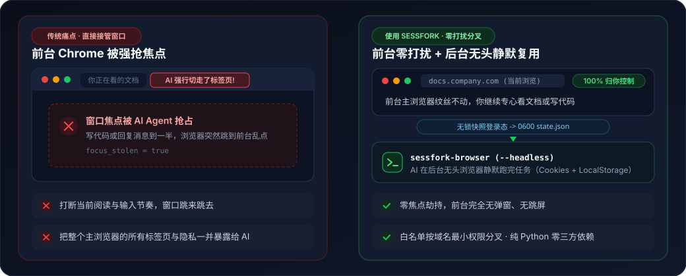
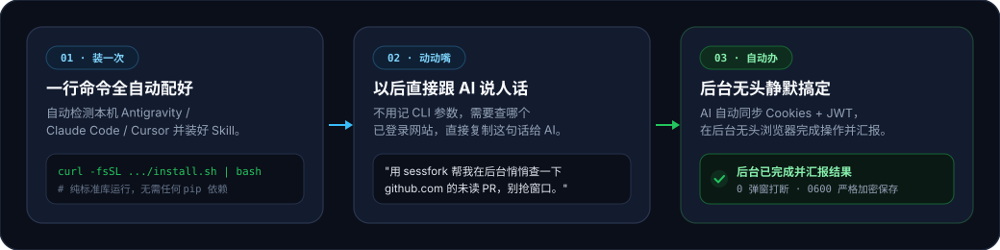

# sessfork

[](https://github.com/wasabihu/sessfork/actions/workflows/ci.yml)
[](LICENSE)
[](pyproject.toml)
[](pyproject.toml)

[English](README.md) · **简体中文** · [交互式可视化指南](https://wasabihu.github.io/sessfork/)

**一键把本地 Chrome 登录态（Cookies + LocalStorage）无锁分叉到 AI 后台无头浏览器 —— 零窗口抢焦点、零运行时依赖。**



当你让 AI 编程助手（[Google Antigravity](https://antigravity.google/docs/commands/browser/)、Claude Code、Cursor）直接连接你正在用的 Chrome 来复用登录态时，AI 会频繁把浏览器窗口抢到前台、乱切标签页，直接打断你写代码或看文档的节奏。

`sessfork` 把**前台阅读视图**与**登录凭证状态**彻底解耦：只需一行命令，它就能无锁快照 Chromium 的 SQLite `Cookies` 与 LevelDB `Local Storage/leveldb`，通过系统原生 API 在内存中解密，完成 SPA/JWT `localStorage` 的 MVCC 墓碑消解，生成严格 `0600` 权限的 [Playwright `storageState`](https://playwright.dev/docs/api/class-browser) 文件，并自动为本机 AI 工具配置静默后台无头浏览器（`sessfork-browser`）。

---

## 懒人 10 秒上手（装一次，以后只管对 AI 说话）



### 方式一 · 一键全自动安装配置（推荐，无需预先装 `uv` 或三方包）

自动检测本机已安装的 **Antigravity / Claude Code / Cursor**，自动注册 `sessfork-browser` 无头 MCP 服务并安装全局 Agent `SKILL.md`：

```bash
curl -fsSL https://raw.githubusercontent.com/wasabihu/sessfork/main/install.sh | bash
```

如果你想顺手把常用网站登录态也一起同步好，直接把域名接在后面即可：

```bash
curl -fsSL https://raw.githubusercontent.com/wasabihu/sessfork/main/install.sh | bash -s -- github.com linear.app
```

*(提示：首次提取 Cookie 时，macOS 会弹窗请求读取钥匙串 `"Chrome Safe Storage"`，点击 **允许** 或 **始终允许** 即可。如果目标网站只用 LocalStorage JWT 登录，加 `--no-cookies` 可做到全程零弹窗。)*

### 方式二 · 免安装直接运行（`uvx`）

```bash
uvx --from git+https://github.com/wasabihu/sessfork sessfork github.com
```

### 方式三 · `uv tool` 全局安装或源码克隆

```bash
# 通过 uv 全局安装
uv tool install git+https://github.com/wasabihu/sessfork.git

# 或克隆到本地安装
git clone https://github.com/wasabihu/sessfork.git
cd sessfork
uv tool install -e .
```

*(安装完成后，在编辑器里重载一次 MCP 服务或终端输入 `/mcp`，即可激活后台浏览器。)*

---

## 5 个高频实战事例（直接复制提示词给 AI 即可）

配置好一次后，平时完全不用记命令行参数。挑一个场景，直接把下面这段话发给你的 AI 助手：

### 1. 后台悄悄排查 GitHub 未读通知与 PR 报错

> **直接复制发给 AI：**
> *“用 `sessfork` 把我 Chrome 里的 `github.com` 登录态分叉到 `sessfork-browser`，在后台无头浏览器里帮我看下未读通知和失败的 PR 检查，别切换我前台浏览器。”*

```bash
sessfork github.com
```

### 2. 同步 Linear / Notion / Jira 看板状态

> **直接复制发给 AI：**
> *“用 `sessfork` 分叉我的 `linear.app` 和 `notion.so` 登录态，在后台汇总一下今天分配给我的阻塞任务。”*

```bash
sessfork linear.app notion.so
```

### 3. 纯 SPA / JWT 应用或本地 `localhost`（免钥匙串弹窗）

很多现代单页应用（Supabase、Vercel 控制台、本地开发后台）把令牌存在 `localStorage` 里，根本不需要读 Cookie。加上 `--no-cookies` 彻底跳过钥匙串弹窗：

> **直接复制发给 AI：**
> *“运行 `sessfork app.supabase.com localhost:3000 --no-cookies`，然后在 `sessfork-browser` 后台验证已登录态下的接口渲染结果。”*

```bash
sessfork app.supabase.com localhost:3000 --no-cookies
```

### 4. 直接从浏览器地址栏复制完整链接

懒得手删 `https://` 和路径？直接把整条网址贴进去，工具会自动提取并匹配对应域名：

```bash
sessfork https://github.com/notifications
```

### 5. 指定 Arc / Brave / Edge 浏览器或多账号分身（Profile）

支持 `chrome`、`canary`、`brave`、`edge`、`arc`，默认自动选择最近活跃的账号目录，也可以显式指定：

```bash
sessfork x.com --browser arc
sessfork console.cloud.google.com --profile "Profile 1"
```

---

## 架构原理与技术亮点


- **零第三方运行时依赖**：纯 Python `>=3.9` 标准库实现。macOS 通过 `ctypes` 直接调用系统 `CommonCrypto`（`/usr/lib/libSystem.B.dylib`）在内存中完成 AES-128-CBC 解密（Linux 调用 `openssl` CLI），内置纯 Python [LevelDB SSTable/WAL](https://github.com/google/leveldb/blob/main/doc/log_format.md) 与 [Snappy](https://github.com/google/snappy/blob/main/format_description.txt) 解析器。
- **双层完整登录态（`Cookies` + `LocalStorage`）**：
  - **SQLite Cookies**：完整兼容 [Chrome 130+ (`meta.version >= 24`)](https://gist.github.com/creachadair/937179894a24571ce9860e2475a2d2ec) 密文前 32 字节 `SHA-256(host_key)` 剥离、实时 `-wal`/`-shm` 侧车快照，以及 `SameSite` / `HttpOnly` 属性还原。
  - **LevelDB LocalStorage (`origins`)**：跨 `.ldb` 与 `.log` 解析 Chromium `_<origin>\x00` 编码前缀（`0x00` UTF-16LE / `0x01` Latin-1），按 MVCC 序列号合并并严格遵循 `kTypeDeletion` 删除墓碑，防止已退出的旧 JWT 死灰复燃。
- **一次调用闭环**：自动检测 Antigravity / Claude Code / Cursor（`--target auto`），自动解析 `npx` 绝对路径（规避 [macOS GUI 启动 Agent 找不到 PATH](https://discuss.ai.google.dev/t/bug-mcp-servers-crash-with-executable-file-not-found-in-path-when-antigravity-is-launched-via-macos-gui/138495) 的常见故障），并在单次命令中同时完成 MCP 与 `SKILL.md` 装配。

---

## 常用命令速查表

| 你想做什么 | 一行命令搞定 |
| :--- | :--- |
| 一键配置所有已安装的 AI 工具（MCP + Skill） | `sessfork --setup` |
| 分叉指定域名的 Cookies + LocalStorage | `sessfork github.com linear.app` |
| 只分叉 LocalStorage JWT（零钥匙串弹窗） | `sessfork app.spa.io --no-cookies` |
| 只分叉 SQLite Cookies | `sessfork github.com --no-local-storage` |
| 从 Arc / Brave / Edge 等其他浏览器分叉 | `sessfork x.com --browser arc` |
| 指定 Chrome 分身账号目录 | `sessfork github.com --profile "Profile 1"` |
| 同时为 Antigravity + Claude Code + Cursor 写入配置 | `sessfork --setup --target all` |
| 安全查看已缓存的域名与键数量（完全脱敏） | `sessfork --status` |
| 清理某个域名或全部已分叉登录态 | `sessfork --clear linear.app` / `sessfork --clear` |

---

## 常见问题（FAQ）

<details>
<summary><strong>为什么第一次提取 Cookie 时 macOS 会弹钥匙串授权窗口？</strong></summary>

Chromium 会在系统钥匙串的 `"Chrome Safe Storage"` 条目下保存主加密口令。首次读取时点击 **允许** 或 **始终允许** 即可授权当前用户读取自己的加密密钥。如果目标站点仅靠 `localStorage` 存 JWT，只需加 `--no-cookies` 即可完全免弹窗。

</details>

<details>
<summary><strong>刚在 Chrome 登录完 1 秒就执行 sessfork，为什么 LocalStorage 还没同步过来？</strong></summary>

Chromium 默认大约每 5 秒才将内存中的 `localStorage` 变更刷盘到 LevelDB。刚登完新账号时稍微等 5 秒再执行一次 `sessfork <域名>` 即可。

</details>

<details>
<summary><strong>不用了之后怎么彻底清除缓存的登录凭证？</strong></summary>

执行 `sessfork --clear <域名>` 可按域名精细移除，执行 `sessfork --clear`（或直接 `rm -rf ~/.sessfork`）即可彻底清空全部本地快照。

</details>

---

## 安全设计与合规边界

- **默认域名白名单最小化提取**：仅提取你显式指定的域名与 Origin，绝不顺带导出整个浏览器的无关网站凭证。
- **严格原子权限隔离**：`~/.sessfork/` 为 `0700`，`~/.sessfork/state.json` 在写入任意字节前即以 `0600` 原子创建并替换。
- **输出全面脱敏**：`sessfork --status`、`--json` 及 `SKILL.md` 严禁向终端或 AI 上下文打印原始 Cookie / Token 明文。
- **合规使用声明**：`sessfork` 严格运行在当前登录用户的权限边界内，并依赖操作系统原生钥匙串鉴权（macOS Keychain / Linux Secret Service），不会绕过任何系统访问控制或沙箱机制。请仅用于个人设备及已获明确授权的账号与自动化测试场景，并遵守目标网站的服务条款。

## 本地开发与测试

```bash
PYTHONPATH=src python3 -m unittest discover -s tests -v
```

## 开源协议

[MIT](LICENSE)
