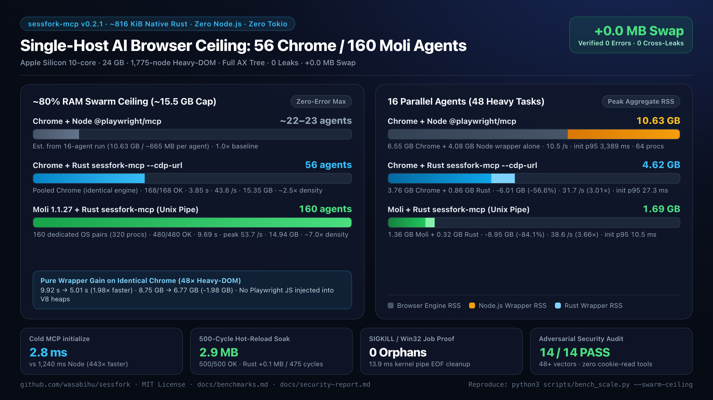

# Stress Tests & Benchmarks



`sessfork` ships three zero-dependency, 100% local benchmark harnesses — [`scripts/stress_test.py`](../scripts/stress_test.py), [`scripts/bench_extended.py`](../scripts/bench_extended.py), and [`scripts/bench_scale.py`](../scripts/bench_scale.py). All run against synthetic Chromium `Cookies` (SQLite WAL + AES-128-CBC v24) and `Local Storage/leveldb` (SSTable + WAL MVCC) fixtures plus a local `127.0.0.1` HTTP auth echo server — **zero external network calls, zero real user browser data, and zero OS Keychain prompts**.

## Reproducing Locally

```bash
# High-scale density ladder (12->24->48 Heavy-DOM), 4/8/16 parallel agent swarm, & 500-cycle soak
python3 scripts/bench_scale.py --min-free-pct 25 --soak-cycles 500

# Progressive ~80% RAM swarm ceiling sweep (Chrome+Rust pooled up to 56, Moli+Rust dedicated up to 160)
python3 scripts/bench_scale.py --swarm-ceiling --min-free-pct 20 --max-stack-rss-mb 15500

# Extended 4-way 12x Heavy-DOM (3 rounds), 100-cycle memory soak, SIGKILL & --cdp-url detach proofs
python3 scripts/bench_extended.py --rounds 3 --soak-cycles 100

# Full 5-scenario suite (includes live @playwright/mcp + chrome-headless-shell E2E)
python3 scripts/stress_test.py

# Head-to-head 12x heavy-DOM (~1,775 nodes/tab) Chrome vs. Moli benchmark
python3 scripts/stress_test.py --heavy-compare

# Fast CLI/storage/concurrency subset (Scenarios 1-3 only, ~2s)
python3 scripts/stress_test.py --skip-mcp
```

---

## Executive Summary: 4-Way 12× Heavy-DOM Head-to-Head (`--cdp-url` Isolates Pure MCP Wrapper Gain)

Measured on **macOS 26.6.2 (Apple Silicon `arm64`)**, **Python 3.14.7**, **`chrome-headless-shell` (`HeadlessChrome/159.0.8154.6`)**, **`moli 1.1.27`**, **`@playwright/mcp@0.0.85`**, **`sessfork-mcp 0.2.1`** (`816.3 KiB` stripped binary).

All **4 stacks** execute the exact same 12-agent authenticated SaaS dashboard workload (**120 table rows, 1,775 DOM nodes/tab = 21,300 live DOM nodes**, 12 unique Cookie + LocalStorage JWTs, setup + interleaved out-of-order verification, **full AX tree snapshots enabled on every navigation**), across **3 measured rounds** (`12/12` isolation checks passed with **`0` cross-context leaks** on every round across all 4 stacks):

| Metric (3-Round Median, 12× Heavy-DOM `isolatedContext`) | `chrome-headless-shell` + Node `@playwright/mcp` | **`chrome-headless-shell` + Rust `sessfork-mcp --cdp-url`** | `moli 1.1.27` + Node `@playwright/mcp` | **`moli 1.1.27` + Rust `sessfork-mcp` (Unix Pipe)** |
| :--- | :---: | :---: | :---: | :---: |
| **MCP Cold `initialize`** *(min–max)* | `1,240.4 ms` *(1,232.7–1,585.9)* | **`3.2 ms`** *(2.9–22.6, **`388×` faster**)* | `1,260.5 ms` *(1,194.8–2,207.0)* | **`2.8 ms`** *(2.7–3.1, **`443×` faster**)* |
| **12× Heavy-DOM Total Time** *(min–max)* | `2,357.9 ms` *(2,349.1–2,535.8)* | **`1,527.8 ms`** *(1,523.4–1,543.3, **`1.54×` faster**)* | `5,451.2 ms` *(5,421.9–5,605.5)* | **`1,509.2 ms`** *(1,491.8–1,544.2, **`1.56×` faster**)* |
| **Total Active RSS** *(Browser + MCP)* | `2,715.1 MB` *(2,708.5–2,716.3)* | **`1,967.3 MB`** *(saves **`747.8 MB` / `-27.5%`**)* | `652.4 MB` *(643.2–653.3)* | **`273.8 MB`** *(**`9.92×` smaller / `-89.9%`**, saves `2.44 GB`)* |
| **Pure Browser Engine RSS** | `2,417.0 MB` | **`1,914.0 MB`** *(`-503.0 MB` on identical Chrome!)* | `381.5 MB` | **`253.0 MB`** *(`-128.5 MB` vs Node+Moli)* |
| **MCP Wrapper RSS** *(under 12× load)* | `298.4 MB` (Node) | **`53.9 MB`** *(Rust peak; `2.1 MB` idle)* | `270.0 MB` (Node) | **`20.7 MB`** *(Rust peak; `1.7 MB` idle)* |
| **Browser OS Process Count** | `15` procs | `16` procs | `1` proc | **`1` proc** (+ `0` TCP ports) |
| **12× Isolation Verification (All Rounds)** | `12 / 12` (`0` leaks) | **`12 / 12` (`0` leaks)** | `12 / 12` (`0` leaks) | **`12 / 12` (`0` leaks)** |

> **Key Architectural Finding — Pure MCP Wrapper Savings on Identical Chromium:**
> Even **without** switching browser engines, replacing Node.js `@playwright/mcp` with pure Rust `sessfork-mcp --cdp-url` on the **exact same `chrome-headless-shell` binary**:
> 1. Cuts cold MCP `initialize` latency by **`388×`** (`1,240.4 ms → 3.2 ms`).
> 2. Cuts 12-context Heavy-DOM wall time by **`1.54×`** (`2,357.9 ms → 1,527.8 ms`).
> 3. Saves **`747.8 MB` (`-27.5%`) total RAM** — not just from removing the `298.4 MB` Node.js wrapper, but also cutting **Chrome's own renderer RSS by `503.0 MB`** (`2,417.0 MB → 1,914.0 MB`) because `sessfork-mcp` calls native CDP `Accessibility.getFullAXTree` directly instead of injecting Playwright's JS aria-snapshot runtime into all 12 V8 context heaps.

### Independent Verification by the `lexmount/moli` Team (Apple M4, 24 GB, 5-Run Medians)

In [lexmount/moli Discussion #3465](https://github.com/lexmount/moli/discussions/3465#discussioncomment-19846839), the Moli team independently reran `python3 scripts/stress_test.py --heavy-compare` on an **Apple M4 (24 GB RAM)** with **1 warm-up + 5 measured runs** (`12/12` isolation checks passed on every run):

| Stack (Apple M4 24 GB, 5-run median) | Total Elapsed Time | Total End RSS | Delta vs. Chrome |
| :--- | :---: | :---: | :--- |
| `chrome-headless-shell` + `@playwright/mcp` | `11.65 s` | `2,439.5 MiB` | baseline |
| `moli` + `@playwright/mcp` (Node) | `25.41 s` | `575.6 MiB` | `-76.4%` RAM, `0.46×` speed |
| **`moli` + `sessfork-mcp` (Rust Pipe)** | **`4.22 s`** | **`226.3 MiB`** | **`-90.7%` RAM (`10.78×` smaller), `2.76×` faster** (`6.02×` faster than Node+Moli) |

---

## High-Scale Density Ladder & 16-Agent Swarm Concurrency (`scripts/bench_scale.py`)

Measured on the same **Apple Silicon 10-core, 24 GB RAM** host (`macOS 26.6.2`, `HeadlessChrome/159.0.8154.6`, `moli 1.1.27`, `sessfork-mcp 0.2.1`, `@playwright/mcp@0.0.85`), with a `25%` free-memory circuit breaker active (**`79%–80%` free memory maintained throughout, `0 MB` net swap growth**).

### 1. Single-Host Concurrency Density Ladder (`12 → 24 → 48` Heavy-DOM, up to 85,200 Live DOM Nodes)

Every tier runs `N` isolated contexts on the 1,775-node Heavy-DOM dashboard with full AX tree snapshots enabled (`0` errors, `0` cross-context leaks across all completed tiers):

| Stack | 12× Heavy-DOM (21.3K DOM) | 24× Heavy-DOM (42.6K DOM) | **48× Heavy-DOM (85.2K DOM)** | Marginal Cost (`MB / ctx`) | 48× Speed | 48× RAM vs. Chrome+Node |
| :--- | :---: | :---: | :---: | :---: | :---: | :--- |
| `chrome-headless-shell` + Node `@playwright/mcp` | `2,710.2 MB` / `2.33 s` (`15` procs) | `4,932.0 MB` / `5.08 s` (`27` procs) | **`8,752.2 MB`** / `9.92 s` (`51` procs, p95 `73.7 ms`) | `167.8 MB/ctx` | `1.00×` | baseline (`8.55 GiB`) |
| **`chrome-headless-shell` + Rust `sessfork-mcp --cdp-url`** | `1,967.8 MB` / `2.49 s` (`16` procs) | `3,637.9 MB` / `2.98 s` (`28` procs) | **`6,769.0 MB`** / **`5.01 s`** (`52` procs, p95 `54.2 ms`) | **`133.4 MB/ctx`** | **`1.98×` faster** | **saves `1.98 GB` (`-22.7%`) on identical Chrome** |
| `moli 1.1.27` + Node `@playwright/mcp` | `645.2 MB` / `5.47 s` (`1` proc) | `897.5 MB` / `11.07 s` (`1` proc) | `1,326.5 MB` / `17.99 s` (`1` proc, p95 `204.2 ms`) | `18.9 MB/ctx` | `0.55×` | `-84.8%` RAM |
| **`moli 1.1.27` + Rust `sessfork-mcp` (Unix Pipe)** | **`276.7 MB`** / **`1.57 s`** (`1` proc) | **`402.1 MB`** / **`3.07 s`** (`1` proc) | **`625.8 MB`** / **`4.90 s`** (`1` proc, p95 **`51.9 ms`**) | **`9.7 MB/ctx`** | **`2.03×` faster** (`3.67×` vs Node+Moli) | **`13.99×` smaller (`-92.8%`, saves `8.13 GB`!)** |

> **Real Upstream Limit Discovered During 96-Context Probing (`moli 1.1.27`):**
> Pushing a **single** `moli 1.1.27` process past **60 concurrent `BrowserContext`s** causes `moli`'s per-process open file descriptors to cross **`1,024` (`FD_SETSIZE`)** (`~17` FDs/context: `KQUEUE` + Unix socketpairs + temp handles; observed `1,063` open FDs at context #60 via `lsof`), triggering `net::ERR_CONNECTION_REFUSED` on subsequent navigations for both Node MCP and Rust MCP (with `0` cross-context leaks).
> **Recommended production architecture:** shard horizontally across multiple `sessfork-mcp` + `moli` worker processes (see Swarm benchmark below — 16 independent processes × 48 contexts = up to `768` contexts with zero FD pressure and full multi-core parallelism).

### 2. Multi-Agent Independent Process Swarm (`4 / 8 / 16` Parallel MCP Servers)

`W` independent agent workers spawn **`W` separate MCP server processes simultaneously**, each opening its own isolated context and running 3 consecutive Heavy-DOM authenticated tasks (`W × 3` total tasks). Aggregate RSS is captured via a `threading.Barrier(W)` while **all `W` workers are loaded and alive simultaneously** (`100%` pass rate, **`0` cross-agent leaks** on every run):

| Parallel Agents | Stack & Deployment Topology | Total Wall Time *(incl. Cold Spawn)* | Throughput (`tasks/s`) | Cold Init p50 / p95 | Nav p50 / p99 | **Peak Aggregate RSS** *(Browser + Wrapper)* | Wrapper-Only RSS | Browser OS Procs |
| :---: | :--- | :---: | :---: | :---: | :---: | :---: | :---: | :---: |
| **4 Agents** *(12 tasks)* | `chrome` + Node `@playwright/mcp` *(4× dedicated)* | `2,061.7 ms` | `5.82 /s` | `1,410 / 1,459 ms` | `68.7 / 90.1 ms` | `2,709.1 MB` | `1,022.8 MB` | `16` |
| **4 Agents** *(12 tasks)* | **`chrome` + Rust `--cdp-url`** *(4× Rust → 1 Chrome pool)* | **`444.0 ms`** | **`27.03 /s`** (`4.64×`) | `7.1 / 8.9 ms` | `62.5 / 130.8 ms` | `1,327.1 MB` (`-51.0%`) | `215.2 MB` | `11` |
| **4 Agents** *(12 tasks)* | **`moli` + Rust Pipe** *(4× dedicated)* | `468.8 ms` | **`25.60 /s`** (`4.40×`) | **`4.7 / 5.5 ms`** | **`59.9 / 63.5 ms`** | **`421.0 MB`** (`-84.5%`) | **`80.0 MB`** | **`4`** |
| **8 Agents** *(24 tasks)* | `chrome` + Node `@playwright/mcp` *(8× dedicated)* | `2,837.3 ms` | `8.46 /s` | `1,483 / 2,052 ms` | `104.3 / 197.9 ms` | `5,418.5 MB` | `2,040.5 MB` | `32` |
| **8 Agents** *(24 tasks)* | **`chrome` + Rust `--cdp-url`** *(8× Rust → 1 Chrome pool)* | `788.6 ms` | **`30.44 /s`** (`3.60×`) | `7.8 / 8.8 ms` | `110.9 / 241.0 ms` | `2,397.4 MB` (`-55.8%`) | `428.7 MB` | `19` |
| **8 Agents** *(24 tasks)* | **`moli` + Rust Pipe** *(8× dedicated)* | **`703.1 ms`** | **`34.14 /s`** (`4.04×`) | **`7.0 / 10.5 ms`** | **`80.8 / 95.7 ms`** | **`844.4 MB`** (`-84.4%`) | **`162.2 MB`** | **`8`** |
| **16 Agents** *(48 tasks)* | `chrome` + Node `@playwright/mcp` *(16× dedicated)* | `4,558.8 ms` | `10.53 /s` | `2,200 / 3,389 ms` | `110.5 / 305.2 ms` | **`10,634.7 MB`** (`10.4 GiB`) | **`4,079.6 MB`** (`4.0 GiB` Node!) | `64` |
| **16 Agents** *(48 tasks)* | **`chrome` + Rust `--cdp-url`** *(16× Rust → 1 Chrome pool)* | `1,513.7 ms` | **`31.71 /s`** (`3.01×`) | `12.3 / 27.3 ms` | `198.7 / 472.3 ms` | **`4,619.9 MB`** (**saves `6.01 GB` / `-56.6%`**) | `857.0 MB` | `35` |
| **16 Agents** *(48 tasks)* | **`moli` + Rust Pipe** *(16× dedicated)* | **`1,245.3 ms`** | **`38.55 /s`** (**`3.66×`**) | **`7.4 / 10.5 ms`** | **`147.7 / 196.3 ms`** | **`1,689.0 MB`** (**`6.30×` smaller / `-84.1%`**, saves **`8.95 GB`**) | **`324.2 MB`** (`12.6×` smaller) | **`16`** |

### 3. Single-Host ~80% RAM Parallel Swarm Ceiling (`--swarm-ceiling`, 24 GB Apple Silicon)

To measure the true **maximum zero-error concurrent agent ceiling** inside a strict **~80% total host RAM budget** (`15.5 GB` benchmark RSS cap on a 24 GB Mac alongside ~`4.2 GB` active OS/IDE footprint, `20%` free-memory floor, and `0 MB` net swap growth), we swept both Rust swarm architectures up to the `15.5 GB` ceiling (every single run verified **`100%` pass rate, `0` cross-agent leaks, and `+0.0 MB` swap growth**):

#### 3a. `chrome-headless-shell` + Rust `sessfork-mcp --cdp-url` (Pooled Chrome, Ceiling: **56 Parallel Agents**)

| Parallel Agents *(×3 Heavy Tasks)* | Passed / Leaks | Total Wall Time | Throughput | Cold Init p50 / p95 | Nav p50 / p99 | Peak Total RSS *(Browser + Rust)* | Browser Procs | Net Swap Growth |
| :---: | :---: | :---: | :---: | :---: | :---: | :---: | :---: | :---: |
| **16 Agents** *(48 tasks)* | `48 / 48` (`0`) | `1.13 s` | `42.61 /s` | `16.1 / 20.6 ms` | `182.8 / 470.5 ms` | `4,627.9 MB` (`3,764 + 865`) | `35` | `+0.0 MB` |
| **32 Agents** *(96 tasks)* | `96 / 96` (`0`) | `2.24 s` | `42.86 /s` | `20.0 / 45.6 ms` | `394.5 / 1,180.0 ms` | `9,038.5 MB` (`7,312 + 1,727`) | `67` | `+0.0 MB` |
| **48 Agents** *(144 tasks)* | `144 / 144` (`0`) | `3.35 s` | `43.05 /s` | `27.8 / 50.1 ms` | `725.2 / 1,472.0 ms` | `13,417.3 MB` (`10,837 + 2,581`) | `99` | `+0.0 MB` |
| **56 Agents** *(168 tasks — ~80% RAM cap)* | **`168 / 168`** (`0`) | **`3.85 s`** | **`43.59 /s`** | **`14.4 / 65.3 ms`** | `789.7 / 1,552.0 ms` | **`15,348.8 MB`** (`12,337 + 3,012`) | `115` | **`+0.0 MB`** |

#### 3b. `moli 1.1.27` + Rust `sessfork-mcp` Unix Pipe (100% Dedicated OS Processes, Ceiling: **160 Parallel Agents / 320 Live Processes**)

| Parallel Agents *(×3 Heavy Tasks)* | Passed / Leaks | Total Wall Time | Throughput | Cold Init p50 / p95 | Nav p50 / p99 | Peak Total RSS *(Moli + Rust)* | Moli Procs | Net Swap Growth |
| :---: | :---: | :---: | :---: | :---: | :---: | :---: | :---: | :---: |
| **16 Agents** *(48 tasks)* | `48 / 48` (`0`) | `0.97 s` | `49.73 /s` | `8.3 / 14.8 ms` | `145.5 / 203.9 ms` | `1,687.1 MB` (`1,363 + 324`) | `16` | `+0.0 MB` |
| **32 Agents** *(96 tasks)* | `96 / 96` (`0`) | `1.88 s` | `51.01 /s` | `11.6 / 24.2 ms` | `282.5 / 399.2 ms` | `3,370.0 MB` (`2,722 + 648`) | `32` | `+0.0 MB` |
| **64 Agents** *(192 tasks)* | `192 / 192` (`0`) | `3.76 s` | `51.12 /s` | `59.7 / 99.5 ms` | `595.5 / 863.2 ms` | `6,315.8 MB` (`5,022 + 1,294`) | `64` | `+0.0 MB` |
| **96 Agents** *(288 tasks)* | `288 / 288` (`0`) | `5.36 s` | **`53.70 /s`** | `44.5 / 105.6 ms` | `865.5 / 1,255.0 ms` | `9,481.8 MB` (`7,541 + 1,941`) | `96` | `+0.0 MB` |
| **128 Agents** *(384 tasks)* | `384 / 384` (`0`) | `7.22 s` | `53.16 /s` | `22.9 / 48.6 ms` | `1,215.7 / 1,797.1 ms` | `12,467.9 MB` (`9,880 + 2,588`) | `128` | `+0.0 MB` |
| **144 Agents** *(432 tasks)* | `432 / 432` (`0`) | `8.64 s` | `50.03 /s` | `38.3 / 137.2 ms` | `1,426.8 / 2,077.2 ms` | `13,463.0 MB` (`10,653 + 2,810`) | `144` | `+0.0 MB` |
| **160 Agents** *(480 tasks — ~80% RAM cap)* | **`480 / 480`** (`0`) | **`9.69 s`** | **`49.53 /s`** | **`23.3 / 57.6 ms`** | `1,670.1 / 2,412.7 ms` | **`14,939.1 MB`** (`11,855 + 3,084`) | **`160`** *(320 live procs)* | **`+0.0 MB`** |

> **Single-Host Capacity Takeaway (`~15.5 GB` benchmark budget / ~80% of 24 GB RAM):**
> - Default **`Chrome` + Node `@playwright/mcp`**: ~`22–23` concurrent agents (`~665 MB/agent`, based on measured `10.63 GB` at 16 agents).
> - **`Chrome` + Rust `sessfork-mcp --cdp-url` (pooled Chrome)**: **`56` verified parallel agents** (`15.35 GB`, `168/168` pass, `0` leaks, `43.59 tasks/s`, `~274 MB/agent`) — **`~2.5×` higher Chrome density**.
> - **`Moli` + Rust `sessfork-mcp` (dedicated OS pipe processes)**: **`160` verified parallel agents** (`14.94 GB`, `480/480` pass, `0` leaks, `49.53 tasks/s` / peak `53.70 tasks/s`, **`~93.4 MB/agent`**) — **`~7×` higher density than Chrome+Node** and **`2.86×` higher than Chrome+Rust**, with **`+0.0 MB` swap growth** across 320 simultaneous live processes.

---

## 500-Cycle High-Frequency Hot-Reload Memory Soak (`scripts/bench_scale.py`)

Runs **500 consecutive token-rotation cycles** (`write fresh state` → `browser_set_storage_state` → `browser_navigate` → assert fresh Cookie & LocalStorage tokens with zero stale reads) to prove long-running zero-leak stability:

| Stack (500 Consecutive Cycles) | Passed / Stale | Total Wall Time | Hot-Reload p50 / p95 / p99 | Nav p50 / p95 | Rust Wrapper RSS (c1 → c25 → c100 → c250 → c500) | Browser RSS (c1 → c100 → c250 → c500) |
| :--- | :---: | :---: | :---: | :---: | :---: | :---: |
| **`moli 1.1.27` + `sessfork-mcp` (Pipe)** | **`500 / 500`** (`0` stale) | **`2,445.8 ms`** (`204 /s`) | **`0.82 ms`** / `0.98 ms` / `1.17 ms` | `3.33 ms` / `4.65 ms` | `2.2 → 2.8 → 2.8 → 2.9 → 2.9 MB` (**`+0.1 MB` over 475 cycles**) | `47.2 → 92.8 → 76.5 → 78.8 MB` *(GC reclaims & stabilizes)* |
| **`chrome-headless-shell 159` + `sessfork-mcp --cdp-url`** | **`500 / 500`** (`0` stale) | **`2,821.9 ms`** (`177 /s`) | **`1.01 ms`** / `1.16 ms` / `1.42 ms` | `3.78 ms` / `4.43 ms` | `2.1 → 2.8 → 2.8 → 2.8 → 2.9 MB` (**`+0.1 MB` over 475 cycles**) | `254.1 → 496.2 → 687.7 → 637.1 MB` *(GC plateaus after c250)* |

> **Zero-Leak Verdict:** Across 500 consecutive hot-reload navigations, **`sessfork-mcp` itself remains pinned at `2.8–2.9 MB` RSS (`+0.1 MB` across cycles 25→500)** on both engines, and **both** browser engines GC and plateau (`moli` settles at `78.8 MB`; `chrome-headless-shell` peaks at `687.7 MB` at cycle 250 and drops back to `637.1 MB` by cycle 500).

---

## Process Lifecycle & Orphan-Freedom Proofs (`scripts/bench_extended.py` & Real Windows 10)

| Proof | Platform & Transport | Verification Procedure | Measured Outcome |
| :--- | :--- | :--- | :--- |
| **`SIGKILL` Hard-Kill Orphan Proof** | macOS `arm64`, Unix FD 3/4 pipe (`--remote-debugging-pipe`) | Launch `sessfork-mcp` + `moli`, load 3 active isolated contexts, `kill -9` parent `sessfork-mcp` | **`0` surviving `moli` orphans**; child auto-exited in **`13.9 ms`** on kernel pipe EOF |
| **External `--cdp-url` Non-Destruction** | macOS `arm64`, pure-std RFC 6455 WS to `HeadlessChrome/159` | Attach via `--cdp-url`, open isolated contexts, test both explicit `browser_close` AND abrupt stdin EOF (`Drop`) | Chrome stayed alive (`true`) and **`0` leaked targets** in `/json/list` for both paths |
| **Real Windows 10 Native QA (`v0.2.1`)** | Windows 10 x64 + Chrome 158 (`v20` ABE) + Win32 Job Object | Zero-flag auto-discovery of `%LOCALAPPDATA%\Moli\bin\moli.exe`, live MCP tools, `Stop-Process -Force` | Cold `initialize` **`10.8 ms`**, loopback navigate `94.1 ms`, `browser_extract_markdown` **`5.7 ms`**, `browser_close` `31.6 ms`, **`0` surviving `moli.exe` orphans**; Companion Extension synced `17` cookies (`11 HttpOnly`) + `128` localStorage keys cleanly |

---

## Core Storage, Concurrency & Playwright Baseline Benchmarks (`scripts/stress_test.py`)

### 1. Extraction Scale & Throughput (SQLite AES-128-CBC + LevelDB SSTable/WAL)

Each domain has 20 encrypted v24 cookies + 20 LocalStorage keys (with WAL overrides and deletion tombstones):

| Tier | Domains | Cookies | LS Keys | `state.json` Size | Cookie Decrypt p50 | LevelDB Parse p50 | Atomic Write p50 | Total p50 / p95 | Cookie Throughput |
| :--- | :---: | :---: | :---: | :---: | :---: | :---: | :---: | :---: | :---: |
| Small | 10 | 200 | 200 | 96.7 KB | 1.35 ms | 1.33 ms | 0.82 ms | **3.64 ms** / 4.15 ms | 147,747 /s |
| Medium | 50 | 1,000 | 1,000 | 484.9 KB | 4.73 ms | 5.83 ms | 1.94 ms | **12.45 ms** / 13.01 ms | 211,543 /s |
| Large | 100 | 2,000 | 2,000 | 974.6 KB | 10.14 ms | 12.79 ms | 3.52 ms | **26.56 ms** / 27.16 ms | 197,229 /s |

### 2. Multi-Process Concurrent Fork Storm (Before vs. After `fcntl.flock`)

> **Real bug caught & fixed by this stress test:** Before adding cross-process `fcntl.flock(LOCK_EX)` locking around the read-modify-write + dual-mirror write cycle in `state.py`, individual `os.replace` writes prevented torn JSON (`0` parse errors), but parallel agents suffered **35.9%–57.5% silent lost updates**. Adding `0600` advisory file locks (`O_NOFOLLOW`) eliminated lost updates completely with ~11–31 ms total wall overhead.

| Workload | Expected Domains | Before Fix (Lost Updates) | After `fcntl.flock` (Lost Updates) | Mirror Diverged | Torn JSON Reads | Total Wall Time |
| :--- | :---: | :---: | :---: | :---: | :---: | :---: |
| 8 processes × 5 rounds | 40 | 23 lost (**57.5%**) | **0 lost (0.0%)** | `false` | 0 | 125.5 ms |
| 16 processes × 4 rounds | 64 | 23 lost (**35.9%**) | **0 lost (0.0%)** | `false` | 0 | 223.7 ms |

### 3. Live SQLite WAL Contention

A background writer continuously hammers a WAL-mode Chromium `Cookies` database (`5,795` commits + `231` `PRAGMA wal_checkpoint(PASSIVE)` calls) while 8 concurrent reader processes perform 200 total `extract_cookies()` runs:

| Metric | Result |
| :--- | :--- |
| Extractions succeeded | **200 / 200 (0.0% errors)** |
| Latency p50 / p95 / p99 | **32.69 ms** / 45.58 ms / 52.05 ms |
| Corrupted / missing cookie rows | **0** |

### 4. Lightweight 6× Auth Contexts & 50-Origin Hot-Reload

| Metric | `chrome-headless-shell` + `@playwright/mcp` | `moli 1.1.27` + `@playwright/mcp` | **`moli 1.1.27` + `sessfork-mcp` (Rust Pipe)** | Delta vs. Chrome |
| :--- | :---: | :---: | :---: | :--- |
| **MCP Cold `initialize`** | `1,787.5 ms` | `1,229.5 ms` | **`4.6 ms`** | **`388×` faster** |
| **Idle MCP Wrapper RSS** | `~272 MB` (Node) | `~273 MB` (Node) | **`1.7 MB`** *(Moli lazy `0 MB`)* | **`~160×` smaller** |
| **50-Origin Hot-Reload p50** *(20 cycles)* | `263.8 ms` | `672.5 ms` | **`5.9 ms`** (`20/20` OK, 0 stale) | **`44.7×` faster** (`114×` vs Node+Moli) |
| **6× `isolatedContext` Total Time** | `3,413.1 ms` | `778.6 ms` | **`230.4 ms`** | **`14.8×` faster** |
| **6× `isolatedContext` Total RSS** | `1,218.9 MB` | `382.5 MB` | **`84.8 MB`** (`82.2` Moli + `2.6` Rust) | **`14.4×` smaller (`-93.0%`)** |

## Caveats & Scope

- Local benchmarks measure against a loopback `127.0.0.1` server; real-world external sites add network RTT and site-specific JS execution time.
- **Engine compatibility trade-off:** Moli's compatibility is 80.7% vs. Chrome's 99.9% on Lexbench (WebGL, strict anti-bot portals, Canvas). **`--engine dual`** (or attaching `sessfork-mcp --cdp-url` to Chromium/CEF when full Blink fidelity is required) gives you the best of both worlds.
- Websites that enforce **single-use refresh token rotation** can still invalidate forked sessions if both foreground Chrome and a headless context refresh concurrently (see the [README FAQ](../README.md#faq)).
- For security threat boundaries and reproducible adversarial verification, see [`docs/security-report.md`](security-report.md).
