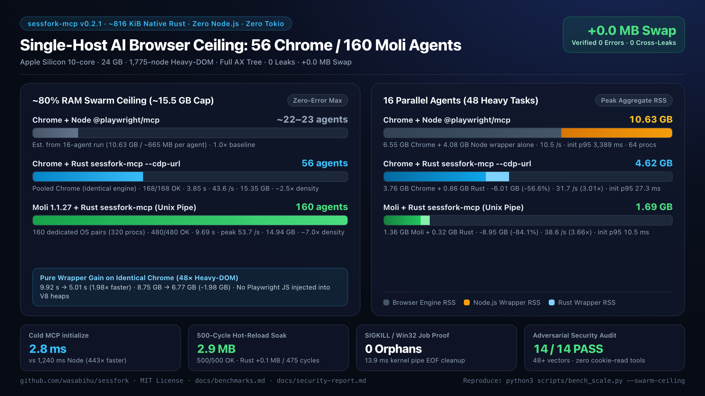

# sessfork-mcp — Native Rust CDP MCP Server (Moli & External Chromium/CEF)

A **~816 KiB**, **zero-Node.js / zero-Tokio** native Rust CDP MCP server (plus built-in Chrome/Edge Native Messaging host) for [`lexmount/moli`](https://github.com/lexmount/moli) **and any local Chromium / `chrome-headless-shell` / CEF CDP browser via `--cdp-url`** — works **completely standalone on macOS, Linux, and Windows** (no Python, no Chrome required) or paired with [`sessfork`](../../README.md) / the [Companion Extension](../../extension/README.md) to fork live Chrome Cookies & LocalStorage into your background agent browser.

On **macOS & Linux**, it talks directly to `moli serve --remote-debugging-pipe` over OS file descriptors 3 & 4 (NUL-framed JSON, zero TCP ports). On **Windows**, it launches `moli.exe serve --host 127.0.0.1 --port 0` (kernel-assigned port, zero TOCTOU) over a pure-std RFC 6455 loopback WebSocket (`34.2 ms` spawn, `0.086 ms/call` vs `23.2 ms` / `0.042 ms/call` on Unix pipe) guarded by a Win32 Job Object (`JOB_OBJECT_LIMIT_KILL_ON_JOB_CLOSE`) and `CREATE_NO_WINDOW`. With **`--cdp-url http://127.0.0.1:<port>`**, it also attaches directly to any running loopback Chromium / CEF / stealth-browser CDP endpoint (disposing only its own created isolated contexts on close/EOF without shutting down the host browser) — replacing the `~298 MB` Node.js `@playwright/mcp` wrapper everywhere.



## Benchmarks (Full AX Tree Enabled, 12× Heavy-DOM & Isolation)

### Independent Verification by the `lexmount/moli` Team (Apple M4, 24 GB, 5-Run Medians)

In [lexmount/moli Discussion #3465](https://github.com/lexmount/moli/discussions/3465#discussioncomment-19846839), the Moli team independently reran `python3 scripts/stress_test.py --heavy-compare` (12 concurrent isolated contexts, 1,775 DOM nodes/tab, 1 warm-up + 5 measured runs, 12/12 isolation checks passing on every run):

| Stack (Apple M4 24 GB, 5-run median) | Total Elapsed Time | Total End RSS | Delta vs. Chrome |
| :--- | :---: | :---: | :--- |
| `chrome-headless-shell` + `@playwright/mcp` | `11.65 s` | `2,439.5 MiB` | baseline |
| `moli` + `@playwright/mcp` (Node) | `25.41 s` | `575.6 MiB` | `-76.4%` RAM, `0.46×` speed |
| **`moli` + `sessfork-mcp` (Rust Pipe)** | **`4.22 s`** | **`226.3 MiB`** | **`-90.7%` RAM (`10.78×` smaller), `2.76×` faster** (`6.02×` vs Node+Moli) |

### Author Apple Silicon Measurements (macOS arm64, 3-Round Medians — 4-Way Heavy-DOM)

Reproducible locally via `python3 scripts/bench_extended.py --rounds 3 --soak-cycles 100` (full 4-way, 100-cycle memory-soak, `SIGKILL` orphan, and Windows 10 data in [docs/benchmarks.md](../../docs/benchmarks.md); live adversarial verification in [docs/security-report.md](../../docs/security-report.md)):

| Metric (12× Heavy-DOM, 1,775 nodes/tab) | Chrome + Node MCP | **Chrome + `sessfork-mcp --cdp-url`** | Moli + Node MCP | **Moli + `sessfork-mcp` (Rust Pipe)** |
| :--- | :---: | :---: | :---: | :---: |
| **MCP Cold `initialize`** | `1,240.4 ms` | **`3.2 ms`** (`388×` faster) | `1,260.5 ms` | **`2.8 ms`** (`443×` faster) |
| **12× Heavy-DOM Time** *(full AX tree)* | `2,357.9 ms` | **`1,527.8 ms`** (`1.54×` faster) | `5,451.2 ms` | **`1,509.2 ms`** (`1.56×` vs Chrome, `3.61×` vs Node+Moli) |
| **12× Heavy-DOM Total RSS** | `2,715.1 MB` (`15` procs) | **`1,967.3 MB`** (**`-747.8 MB` / `-27.5%`** on identical Chrome!) | `652.4 MB` (`1` proc) | **`273.8 MB`** (`1` proc, **`9.92×` smaller / `-89.9%`**) |
| **48× Heavy-DOM Scaling** *(85.2K DOM)* | `8,752.2 MB` / `9.92 s` (`167.8 MB/ctx`) | **`6,769.0 MB` / `5.01 s`** (**`1.98×` faster**, saves `1.98 GB`) | `1,326.5 MB` / `17.99 s` | **`625.8 MB` / `4.90 s`** (**`13.99×` smaller / `-92.8%`**, `9.7 MB/ctx`) |
| **16 Parallel Agents Swarm** *(48 tasks)* | `10,634.7 MB` (`4.08 GB` Node!) / `10.53 /s` | **`4,619.9 MB` / `31.71 /s`** *(pooled Chrome, `-56.6%` RAM, `3.01×`)* | — | **`1,689.0 MB` / `38.55 /s`** *(16 dedicated procs, **`-84.1%` RAM, `3.66×`**)* |
| **~80% RAM Swarm Ceiling** *(24 GB host)* | `~22–23` agents *(est. at `665 MB/agent`)* | **`56` parallel agents** (`15.35 GB`, `168/168` OK, `43.6 /s`, `0` swap) | — | **`160` parallel agents** (`14.94 GB`, `480/480` OK, `49.5 /s`, `320` procs, `0` swap) |
| **500-Cycle Hot-Reload Soak** | — | **`500/500`** (`1.01 ms` p50, Rust flat `2.9 MB`) | — | **`500/500`** (`0.82 ms` p50, Rust flat `2.9 MB`) |

### Attach Directly to Any Local Chromium / CEF / Stealth Browser (`--cdp-url`, Zero Moli Required)

```bash
# Attach pure Rust sessfork-mcp to any loopback CDP port (strict loopback SSRF allowlist;
# creates isolated BrowserContexts and disposes only its own contexts on close/EOF):
sessfork-mcp --cdp-url http://127.0.0.1:9222
```

## 30-Second Standalone Setup (Moli Only — No Python, Node.js, or Chrome Required)

### 1. Install `moli` & `sessfork-mcp`

```bash
# Install Moli (if not already installed)
curl --proto '=https' --tlsv1.2 -fsSL \
  https://github.com/lexmount/moli/releases/latest/download/moli-installer.sh | sh

# Install prebuilt ~784 KiB sessfork-mcp (macOS arm64/x64, Linux x64/arm64, SHA-256 verified)
curl --proto '=https' --tlsv1.2 -fsSL https://raw.githubusercontent.com/wasabihu/sessfork/v0.2.1/install.sh | bash -s -- --rust-mcp-only
```

**Windows (PowerShell — 1 command, zero Python / zero Node.js; auto-installs `moli.exe`, registers fixed extension ID, wires AI clients):**

```powershell
powershell -ExecutionPolicy ByPass -c "irm https://raw.githubusercontent.com/wasabihu/sessfork/main/install.ps1 | iex"
```

Or build from source (Rust `>=1.88`, ~5 seconds) or grab archives + `SHA256SUMS.txt` from [GitHub Releases](https://github.com/wasabihu/sessfork/releases):

```bash
cargo install --git https://github.com/wasabihu/sessfork sessfork-mcp
```

### 2. Wire into Your AI Coding Agent

`sessfork-mcp` auto-detects `moli` (from `PATH`, `~/.local/bin/moli`, `/opt/homebrew/bin/moli`, or `SESSFORK_MOLI_PATH`) and defaults `--output-dir` to `~/.sessfork/playwright-output` — so it works with zero flags out of the box:

**Claude Code:**

```bash
claude mcp add moli-browser -- ~/.local/bin/sessfork-mcp
```

**Codex CLI:**

```bash
codex mcp add moli-browser -- ~/.local/bin/sessfork-mcp
```

**Cursor / Antigravity / Generic MCP JSON:**

```json
{
  "mcpServers": {
    "moli-browser": {
      "command": "/Users/you/.local/bin/sessfork-mcp"
    }
  }
}
```

*(Pass `"args": ["--layout"]` if you want `browser_take_screenshot` with Moli's on-demand layout engine.)*

### 3. Optional · Add Live Chrome Login Sessions (`sessfork`)

Want your Moli MCP agent to browse **authenticated** sites (GitHub, Linear, Notion, X, etc.) using your live Chrome Cookies & LocalStorage — with automatic fallback to Chrome for WebGL / strict anti-bot portals?

```bash
# Install full sessfork + sessfork-mcp together, then enable Dual mode (Rust Moli primary + lazy 0 MB Chrome fallback)
curl --proto '=https' --tlsv1.2 -fsSL https://raw.githubusercontent.com/wasabihu/sessfork/v0.2.1/install.sh | bash -s -- --with-rust-mcp
sessfork --engine dual
sessfork github.com linear.app
```

See the main [sessfork README](../../README.md) for full session-forking docs.

## CLI Options & Subcommands

| Flag / Subcommand | Default | Description |
| :--- | :--- | :--- |
| `--moli <PATH>` | auto-detected | Explicit path to the `moli` / `moli.exe` binary (`SESSFORK_MOLI_PATH` also supported) |
| `--cdp-url <URL>` | none | Attach directly to any running loopback CDP browser (`http://127.0.0.1:<port>`, `http://localhost:<port>`, or `ws://127.0.0.1:<port>/<path>`) — no Moli binary required; strict fail-closed loopback SSRF allowlist; disposes only created contexts on close/EOF without killing the host browser |
| `--storage-state <PATH>` | none | Optional initial Playwright `storageState` JSON to hydrate on startup |
| `--output-dir <PATH>` | `~/.sessfork/playwright-output` | Confined sandbox root for `browser_set_storage_state` hot-reload & screenshots |
| `--layout` | off (DOM-first) | Enable Moli's on-demand layout engine (required for screenshots) |
| `--compact` | off | Default snapshots to zero-layout distilled interactive+semantic view & active-modal scoping |
| `--diff` | off | Default `click`/`type`/`press_key` to Action Receipts (`OK` / `WARNING: NO_OP`) + shift-invariant `+/-` diffs (cuts 8-step cumulative input tokens by **85.4%**) |
| `native-host` | auto-detected on Chrome launch | Run Chrome/Edge Native Messaging host (`com.wasabihu.sessfork`) for the [Companion Extension](../../extension/README.md) |
| `register-host [--extension-id <ID>]` | fixed ID + `--browser all` | Register Native Messaging manifest in Chrome / Edge / Brave / Chromium (HKCU Registry on Windows, JSON manifest on macOS/Linux; defaults to official fixed extension ID `eipgnmlpcpmadpbignmifidnbjfmlphm`) |
| `setup --mcp-file <PATH>` | `--name sessfork-moli` | Atomically wire `sessfork-mcp` into an MCP JSON config (zero Python needed) |

## Small-Model Ergonomic Mode (`--compact --diff`, Zero Layout)

Running `sessfork-mcp --compact --diff` (or passing per-call `compact`, `diff`, `scopeModal` flags) keeps the exact same 16 tools and zero-layout Moli speed while slashing LLM context overhead:

- **Zero-layout observation distillation (`--compact`)**: Strips non-interactive boilerplate and deep YAML indentation straight from CDP `Accessibility.getFullAXTree` (never invokes `getBoundingClientRect` / layout), surfacing `[disabled]`/`[checked]`/`[selected]`/`[invalid]` states plus `heading`/`alert`/`status` callouts.
- **Active modal scoping (`scopeModal`)**: When an active `alertdialog` or `aria-modal="true"` `dialog` opens, scopes the snapshot strictly to the modal subtree and suppresses obscured background controls.
- **Action Receipts + shift-invariant `+/-` diffs + `NO_OP` guard (`--diff`)**: Uses a per-document persistent `RefRegistry` (`backendDOMNodeId -> eN`) so existing refs stay stable across same-page DOM updates, returns only `+/-` diffs on mutations, and emits `WARNING: NO_OP` with zero redundant snapshot payload when clicking disabled/inert controls.

## Native WebMCP & Structure-First Markdown (Zero Clicks, Zero Layout)

`sessfork-mcp` bridges Moli's native [`WebMCP`](https://github.com/lexmount/moli/blob/main/moli-playground/webmcp/README.md) CDP domain and DOM-first runtime directly into MCP:

- **Zero-click WebMCP discovery & execution** (`browser_webmcp_list` + `browser_webmcp_call`): Discover and call a page's native `document.modelContext` / `<form toolname="...">` tools with typed JSON arguments — inheriting the tab's forked Chrome auth session automatically, and failing closed unless `confirm: true` is passed for manual-confirm declarative forms.
- **Structure-first Markdown extraction** (`browser_extract_markdown`): Convert live SPA DOM (or a scoped CSS `selector` like `main` / `article`) straight into clean Markdown without triggering Moli's layout or paint engines.

```text
1. browser_navigate { "url": "https://googlechromelabs.github.io/webmcp-tools/demos/pizza-maker/", "snapshot": false }
2. browser_webmcp_list { "waitMs": 3000 }
3. browser_webmcp_call { "name": "set_pizza_size", "arguments": { "size": "Large" } }
4. browser_webmcp_call { "name": "add_topping", "arguments": { "topping": "🍍", "size": "Large", "count": 3 } }
5. browser_extract_markdown { "maxChars": 4000 }
```

## Exposed Tools & Security Guarantees

- **16 core tools**: `browser_navigate`, `browser_snapshot`, `browser_extract_markdown` (structure-first DOM-to-Markdown), `browser_webmcp_list`, `browser_webmcp_call` (imperative + declarative WebMCP with manual-confirm guard), `browser_tabs` (including named `isolatedContext` sandboxes), `browser_set_storage_state`, `browser_click`, `browser_type` (React/Vue compatible), `browser_press_key`, `browser_evaluate` (sync + async), `browser_navigate_back`, `browser_wait_for`, `browser_console_messages`, `browser_take_screenshot` (with `--layout`), and `browser_close`.
- **Zero raw secret export tools**: Deliberately omits `browser_cookie_list`, `browser_cookie_get`, `browser_storage_state`, and `browser_localstorage_get` so raw session tokens are never echoed into LLM context.
- **Strict `--output-dir` confinement**: Canonicalizes paths and rejects `..` traversal and symlinks escaping `--output-dir`.
- **Zero orphan `moli` processes**: Uses OS pipe FD 3/4 (`--remote-debugging-pipe`); even if `sessfork-mcp` receives `SIGKILL`, the kernel closes FD 3 and `moli` terminates cleanly.
