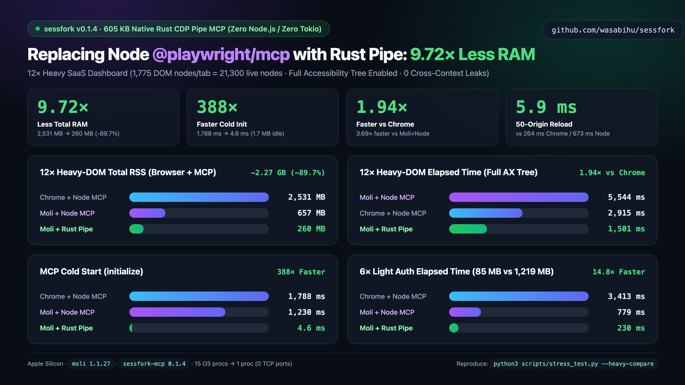

# sessfork-mcp — Native Rust MCP Server for Moli

A **~784 KiB**, **zero-Node.js / zero-Tokio** native Rust MCP server (plus built-in Chrome/Edge Native Messaging host) for [`lexmount/moli`](https://github.com/lexmount/moli) — works **completely standalone on macOS, Linux, and Windows** (no Python, no Chrome required) or paired with [`sessfork`](../../README.md) / the [Companion Extension](../../extension/README.md) to fork live Chrome Cookies & LocalStorage into your background agent browser.

On **macOS & Linux**, it talks directly to `moli serve --remote-debugging-pipe` over OS file descriptors 3 & 4 (NUL-framed JSON, zero TCP ports). On **Windows**, it launches `moli.exe serve --host 127.0.0.1 --port 0` (kernel-assigned port, zero TOCTOU) over a pure-std RFC 6455 loopback WebSocket (`34.2 ms` spawn, `0.086 ms/call` vs `23.2 ms` / `0.042 ms/call` on Unix pipe) guarded by a Win32 Job Object (`JOB_OBJECT_LIMIT_KILL_ON_JOB_CLOSE`) and `CREATE_NO_WINDOW` — replacing the `~272 MB` Node.js `@playwright/mcp` wrapper and eliminating `npx` cold starts and orphan browser processes across all three platforms.



## Benchmarks (Full AX Tree Enabled, 12× Heavy-DOM & Isolation)

### Independent Verification by the `lexmount/moli` Team (Apple M4, 24 GB, 5-Run Medians)

In [lexmount/moli Discussion #3465](https://github.com/lexmount/moli/discussions/3465#discussioncomment-19846839), the Moli team independently reran `python3 scripts/stress_test.py --heavy-compare` (12 concurrent isolated contexts, 1,775 DOM nodes/tab, 1 warm-up + 5 measured runs, 12/12 isolation checks passing on every run):

| Stack (Apple M4 24 GB, 5-run median) | Total Elapsed Time | Total End RSS | Delta vs. Chrome |
| :--- | :---: | :---: | :--- |
| `chrome-headless-shell` + `@playwright/mcp` | `11.65 s` | `2,439.5 MiB` | baseline |
| `moli` + `@playwright/mcp` (Node) | `25.41 s` | `575.6 MiB` | `-76.4%` RAM, `0.46×` speed |
| **`moli` + `sessfork-mcp` (Rust Pipe)** | **`4.22 s`** | **`226.3 MiB`** | **`-90.7%` RAM (`10.78×` smaller), `2.76×` faster** (`6.02×` vs Node+Moli) |

### Author Apple Silicon Measurements (macOS arm64, M5 24 GB)

Reproducible locally via `python3 scripts/stress_test.py --heavy-compare` (full methodology in [docs/benchmarks.md](../../docs/benchmarks.md)):

| Metric | Chrome + Node MCP | Moli + Node MCP | **Moli + `sessfork-mcp` (Rust Pipe)** |
| :--- | :---: | :---: | :---: |
| **MCP Cold `initialize`** | `1,787.5 ms` | `1,229.5 ms` | **`4.6 ms`** (`1.7 MB` idle RSS) |
| **50-Origin Hot-Reload p50** | `263.8 ms` | `672.5 ms` | **`5.9 ms`** (0 stale cookies/LS) |
| **6× Light Auth Time / RAM** | `3,413 ms` / `1,219 MB` | `779 ms` / `383 MB` | **`230 ms` / `85 MB`** (`14.8×` faster / `-93%`) |
| **12× Heavy-DOM RSS** *(1,775 nodes/tab)* | `2,531.4 MB` (`15` procs) | `656.8 MB` (`1` proc) | **`260.4 MB`** (`1` proc, **`9.72×` smaller**) |
| **12× Heavy-DOM Time** *(full AX tree)* | `2,915.4 ms` | `5,543.9 ms` | **`1,501.0 ms`** (**`1.94×` faster than Chrome**) |

## 30-Second Standalone Setup (Moli Only — No Python, Node.js, or Chrome Required)

### 1. Install `moli` & `sessfork-mcp`

```bash
# Install Moli (if not already installed)
curl --proto '=https' --tlsv1.2 -fsSL \
  https://github.com/lexmount/moli/releases/latest/download/moli-installer.sh | sh

# Install prebuilt ~784 KiB sessfork-mcp (macOS arm64/x64, Linux x64/arm64, SHA-256 verified)
curl --proto '=https' --tlsv1.2 -fsSL https://raw.githubusercontent.com/wasabihu/sessfork/v0.1.6/install.sh | bash -s -- --rust-mcp-only
```

**Windows (PowerShell — zero Python / zero Node.js):**

```powershell
powershell -ExecutionPolicy ByPass -c "irm https://github.com/lexmount/moli/releases/latest/download/moli-installer.ps1 | iex"
powershell -ExecutionPolicy ByPass -c "irm https://raw.githubusercontent.com/wasabihu/sessfork/main/install.ps1 | iex"
```

Or build from source (Rust `>=1.88`, ~5 seconds) or grab archives + `SHA256SUMS.txt` from [GitHub Releases](https://github.com/wasabihu/sessfork/releases):

```bash
cargo install --git https://github.com/wasabihu/sessfork sessfork-mcp
```

### 2. Wire into Your AI Coding Agent

`sessfork-mcp` auto-detects `moli` (from `PATH`, `~/.local/bin/moli`, `/opt/homebrew/bin/moli`, or `SESSFORK_MOLI_PATH`) and defaults `--output-dir` to `~/.sessfork/playwright-output` — so it works with zero flags out of the box:

**Claude Code:**

```bash
claude mcp add moli-browser -- ~/.local/bin/sessfork-mcp
```

**Codex CLI:**

```bash
codex mcp add moli-browser -- ~/.local/bin/sessfork-mcp
```

**Cursor / Antigravity / Generic MCP JSON:**

```json
{
  "mcpServers": {
    "moli-browser": {
      "command": "/Users/you/.local/bin/sessfork-mcp"
    }
  }
}
```

*(Pass `"args": ["--layout"]` if you want `browser_take_screenshot` with Moli's on-demand layout engine.)*

### 3. Optional · Add Live Chrome Login Sessions (`sessfork`)

Want your Moli MCP agent to browse **authenticated** sites (GitHub, Linear, Notion, X, etc.) using your live Chrome Cookies & LocalStorage — with automatic fallback to Chrome for WebGL / strict anti-bot portals?

```bash
# Install full sessfork + sessfork-mcp together, then enable Dual mode (Rust Moli primary + lazy 0 MB Chrome fallback)
curl --proto '=https' --tlsv1.2 -fsSL https://raw.githubusercontent.com/wasabihu/sessfork/v0.1.6/install.sh | bash -s -- --with-rust-mcp
sessfork --engine dual
sessfork github.com linear.app
```

See the main [sessfork README](../../README.md) for full session-forking docs.

## CLI Options & Subcommands

| Flag / Subcommand | Default | Description |
| :--- | :--- | :--- |
| `--moli <PATH>` | auto-detected | Explicit path to the `moli` / `moli.exe` binary (`SESSFORK_MOLI_PATH` also supported) |
| `--storage-state <PATH>` | none | Optional initial Playwright `storageState` JSON to hydrate on startup |
| `--output-dir <PATH>` | `~/.sessfork/playwright-output` | Confined sandbox root for `browser_set_storage_state` hot-reload & screenshots |
| `--layout` | off (DOM-first) | Enable Moli's on-demand layout engine (required for screenshots) |
| `native-host` | auto-detected on Chrome launch | Run Chrome/Edge Native Messaging host (`com.wasabihu.sessfork`) for the [Companion Extension](../../extension/README.md) |
| `register-host --extension-id <ID>` | `--browser all` | Register Native Messaging manifest in Chrome / Edge / Brave / Chromium (HKCU Registry on Windows, JSON manifest on macOS/Linux) |
| `setup --mcp-file <PATH>` | `--name sessfork-moli` | Atomically wire `sessfork-mcp` into an MCP JSON config (zero Python needed) |

## Native WebMCP & Structure-First Markdown (Zero Clicks, Zero Layout)

`sessfork-mcp` bridges Moli's native [`WebMCP`](https://github.com/lexmount/moli/blob/main/moli-playground/webmcp/README.md) CDP domain and DOM-first runtime directly into MCP:

- **Zero-click WebMCP discovery & execution** (`browser_webmcp_list` + `browser_webmcp_call`): Discover and call a page's native `document.modelContext` / `<form toolname="...">` tools with typed JSON arguments — inheriting the tab's forked Chrome auth session automatically, and failing closed unless `confirm: true` is passed for manual-confirm declarative forms.
- **Structure-first Markdown extraction** (`browser_extract_markdown`): Convert live SPA DOM (or a scoped CSS `selector` like `main` / `article`) straight into clean Markdown without triggering Moli's layout or paint engines.

```text
1. browser_navigate { "url": "https://googlechromelabs.github.io/webmcp-tools/demos/pizza-maker/", "snapshot": false }
2. browser_webmcp_list { "waitMs": 3000 }
3. browser_webmcp_call { "name": "set_pizza_size", "arguments": { "size": "Large" } }
4. browser_webmcp_call { "name": "add_topping", "arguments": { "topping": "🍍", "size": "Large", "count": 3 } }
5. browser_extract_markdown { "maxChars": 4000 }
```

## Exposed Tools & Security Guarantees

- **16 core tools**: `browser_navigate`, `browser_snapshot`, `browser_extract_markdown` (structure-first DOM-to-Markdown), `browser_webmcp_list`, `browser_webmcp_call` (imperative + declarative WebMCP with manual-confirm guard), `browser_tabs` (including named `isolatedContext` sandboxes), `browser_set_storage_state`, `browser_click`, `browser_type` (React/Vue compatible), `browser_press_key`, `browser_evaluate` (sync + async), `browser_navigate_back`, `browser_wait_for`, `browser_console_messages`, `browser_take_screenshot` (with `--layout`), and `browser_close`.
- **Zero raw secret export tools**: Deliberately omits `browser_cookie_list`, `browser_cookie_get`, `browser_storage_state`, and `browser_localstorage_get` so raw session tokens are never echoed into LLM context.
- **Strict `--output-dir` confinement**: Canonicalizes paths and rejects `..` traversal and symlinks escaping `--output-dir`.
- **Zero orphan `moli` processes**: Uses OS pipe FD 3/4 (`--remote-debugging-pipe`); even if `sessfork-mcp` receives `SIGKILL`, the kernel closes FD 3 and `moli` terminates cleanly.
